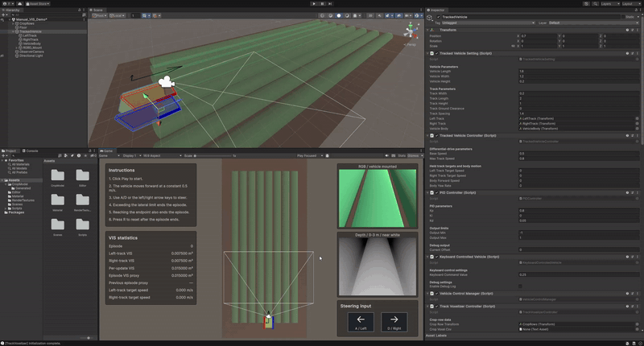

<a id="english"></a>

<kbd>[English](#english)</kbd> &nbsp; <kbd>[中文](#chinese)</kbd>

# Voxel Intrusion Score (VIS) Calculation Demo

## Overview

This Unity demo shows how the **Voxel Intrusion Score (VIS)** quantifies spatial intrusion as a tracked vehicle navigates synthetic crop rows. The algorithm uses spatial hashing to retrieve nearby crop-voxel centers for each track-voxel center. The demo displays per-update VIS and the episode-level **Voxel Intrusion Volume Proxy**, together with a top-down view and onboard RGB/depth previews. Both quantities use a center-proximity criterion; neither represents exact geometric intersection volume or measured crop damage.

**Source paper:** *Digital Twin–Enabled Physical–Virtual Integration for Dense Crop-Row Navigation: Depth-Based Reinforcement Learning with Voxel Intrusion Feedback* (DOI to be added after publication).

The VIS calculation corresponds to Section 4.3, Equations (3)–(8), and Algorithm 1 of the paper. The project includes synthetic example data.

**Unity version:** 2023.2.13f1, Built-in Render Pipeline.

## Demo Preview



## Project Structure

The main source files and assets are listed below:

```text
20261109_18_VIS_manual_demo/
├── Assets/
│   ├── Scenes/Manual_VIS_Demo.unity
│   ├── Scripts/
│   │   ├── CropRowVIS/                 # VIS calculation and voxel visualization
│   │   ├── Vehicle/
│   │   │   ├── KeyboardControlledVehicle.cs
│   │   │   ├── VehicleControlManager.cs # 0.1 s control interval
│   │   │   ├── PIDController.cs        # PD-type command mapping
│   │   │   ├── TrackedVehicleController.cs # Target track speeds and vehicle motion
│   │   │   ├── TrackedVehicleSetting.cs # Vehicle dimensions and shared track gauge
│   │   │   └── ArrowVisualizer.cs      # Forward and steering arrows
│   │   ├── Camera/                    # Depth display and crop opacity
│   │   └── ManualDemoHUD.cs            # Panels, key feedback, episodes, and reset
│   ├── Editor/
│   │   ├── PrepareManualScene.cs       # Scene setup and component binding
│   │   ├── DemoGeometry.cs             # Synthetic geometry and voxel-center generation
│   │   └── VISDemoParameters.json      # Geometry generation parameters
│   ├── CropModel/Generated/
│   │   ├── HalfCylinder.asset
│   │   └── SyntheticCenters.bytes
│   ├── Material/                      # Materials and depth shader
│   └── RenderTextures/                # RGB/depth preview textures
├── Packages/
├── ProjectSettings/
├── figures/VIS_manual_demo1_w800_fps10.gif
├── .gitignore
├── LICENSE.md                      # Bilingual custom non-commercial license
└── README.md                       # Bilingual documentation
```

Library, Temp, Logs, and UserSettings are generated locally by Unity and excluded by .gitignore.

## Modules

| Module | Main scripts | Function |
|---|---|---|
| Geometry and input | DemoGeometry, VoxelData | Generate and load crop-voxel and track-voxel centers. |
| Spatial hashing | SpatialOptimizer | Index crop centers and retrieve local candidate points. |
| VIS calculation | OverlapDetector, StatisticsCalculator, TrackVoxelizerController | Apply the center-proximity criterion to calculate per-update VIS and the episode-level proxy. |
| Vehicle control | KeyboardControlledVehicle, PIDController, VehicleControlManager, TrackedVehicleController | Update PD-type command mapping and differential-drive kinematics every 0.1 s (10 Hz), then integrate vehicle motion using the held target speeds of the left and right tracks. |
| Visualization | ManualDemoHUD, VoxelVisualizer, ArrowVisualizer, camera scripts | Display VIS statistics, voxel classification markers, forward/steering arrows, and RGB/depth previews. |

## Usage

1. Open the project folder in **Unity Hub** using Unity **2023.2.13f1**, and wait for asset import to finish.
2. If the demo scene does not open automatically, open **Assets/Scenes/Manual_VIS_Demo.unity**.
3. Click **Play**, then click the **Game** view to give it keyboard focus.
4. The vehicle moves forward automatically at a constant **0.5 m/s**. Steer using **A/D** or the **left/right arrow keys**.
5. An episode ends when the vehicle reaches the endpoint or exceeds the lateral limit. Press **R** to reset and start the next episode.

Press **Space** to pause or resume the current episode. The top-down camera remains fixed while the vehicle moves through the view. Enable **Gizmos** in the Game view to see track-voxel classification markers and floating arrows: the forward arrow follows the vehicle heading, while the lateral arrow indicates the direction and magnitude of the steering command before PD mapping. The arrows are drawn using Unity Editor Gizmos and are not displayed in standalone player builds.

The **Steering input** panel at the bottom right shows left and right direction buttons. Holding **A/left arrow** or **D/right arrow** gives the corresponding button a blue glow, which disappears when the key is released. This panel only indicates keyboard input status.

You can also press **R** during an episode to restart: the current episode proxy is saved as the previous episode proxy, the current statistics are cleared, and the episode number is incremented.

The VIS panel displays the current episode number, left-track VIS, right-track VIS, current total VIS, current episode proxy, and previous episode proxy. Per-update VIS is the number of track voxels satisfying the criterion multiplied by the voxel volume. The episode-level proxy is the number of unique crop-center indices satisfying the criterion over the entire episode multiplied by the voxel volume. Both are displayed in m³. The episode-level proxy is neither a sum nor a time integral of per-update VIS.

The last two lines of the panel show the target speeds of the left and right tracks currently held by the differential-drive control module, in m/s.

Keyboard commands replace the output of an autonomous policy. The execution chain corresponds to Sections 5.1.3 and 4.4: PD-type command mapping, limiting, target yaw rate, target speeds of the left and right tracks, and ideal vehicle motion without slip. The default forward speed is 0.5 m/s, the track gauge (distance between track centerlines) is 1.4 m, and the maximum speed of each track is 0.8 m/s. A positive command indicates a left turn; its sign is converted when applying rotation about Unity's Y axis.

## Inspector Settings

Make adjustments outside Play mode and save the scene (**Ctrl+S**) to retain the settings. Startup and script reloads preserve the existing Inspector configuration.

| Select in Hierarchy | Component / field | Purpose |
|---|---|---|
| TrackedVehicle | Manual Demo HUD → Start X Position, Start Z Position, End Z Position, Max Lateral Offset | Set the starting X/Z coordinates, endpoint Z coordinate, and lateral limit in world coordinates. This starting position is used both on entering Play mode and on pressing R, with Y fixed at 0. The crop row nearest the starting X coordinate is used as the lateral reference. In the currently saved scene, the starting position is X = 0.7 m, Z = 0 m; the endpoint is Z = 23 m; and the lateral threshold is 0.7 m. |
| TrackedVehicle | Manual Demo HUD → Help Panel Position, Stats Panel Bottom Offset | Adjust the positions of the two panels on the left. |
| TrackedVehicle | Manual Demo HUD → Steering Panel Bottom Offset | Adjust the steering feedback panel using offsets from the right and bottom edges. |
| TrackedVehicle | Manual Demo HUD → RGB Panel Top Right Offset, Depth Panel Top Right Offset | Adjust each preview panel's offsets from the right and top edges: increasing X moves the panel left, and increasing Y moves it down. |
| TrackedVehicle | Tracked Vehicle Controller → Base Speed, Max Track Speed; Tracked Vehicle Setting → Track gauge (s) | Set the differential-drive parameters; the angular velocity limit is derived automatically. During Play, the control component shows the held target track speeds and the corresponding vehicle motion quantities. |
| TrackedVehicle | Arrow Visualizer | Adjust arrow visibility, color, length, thickness, height, and steering-command text. Editor Preview Offset is used for previews outside Play mode. |
| ObserverCamera | Transform; Camera → Size | Adjust the fixed top-down view. |
| ObserverCamera | Observer Crop Transparency → Opacity | Adjust crop opacity in the top-down and Scene views. |

## License and Commercial Authorization

This project is provided for **non-commercial research and evaluation** under the [Custom Non-Commercial Research and Evaluation License](LICENSE.md#english). Use, modification, and redistribution must comply with that license. Commercial use requires separate written authorization. Please contact the corresponding author of the source paper at [jwang@zju.edu.cn](mailto:jwang@zju.edu.cn). Any patent license is limited to the scope expressly specified in the license document.

This project makes its source code available subject to restrictions on use. It is not released under a standard open-source license that permits unrestricted commercial use.

---

<a id="chinese"></a>

<kbd>[English](#english)</kbd> &nbsp; <kbd>[中文](#chinese)</kbd>

# 体素侵入评分（VIS）计算演示

## 概述

本 Unity Demo 演示履带车辆在合成作物行内导航时，如何通过**体素侵入评分（Voxel Intrusion Score，VIS）**量化空间侵入。算法利用空间哈希，为各履带体素中心检索邻近的作物体素中心。Demo 显示单次更新 VIS 和回合级**体素侵入体积代理量（Voxel Intrusion Volume Proxy）**，并提供俯视画面及车载 RGB／深度预览。两种量均采用中心邻近判据，不是精确的几何相交体积或实测作物损伤。

**来源论文：** *Digital Twin–Enabled Physical–Virtual Integration for Dense Crop-Row Navigation: Depth-Based Reinforcement Learning with Voxel Intrusion Feedback*（发表后补充 DOI）。

VIS 计算对应论文第 4.3 节、式（3）–（8）及算法 1。项目包含合成示例数据。

**Unity 版本：**2023.2.13f1，Built-in Render Pipeline。

## 演示预览


## 项目结构

主要源码与资源如下：

```text
20261109_18_VIS_manual_demo/
├── Assets/
│   ├── Scenes/Manual_VIS_Demo.unity
│   ├── Scripts/
│   │   ├── CropRowVIS/                 # VIS 计算及体素可视化
│   │   ├── Vehicle/
│   │   │   ├── KeyboardControlledVehicle.cs
│   │   │   ├── VehicleControlManager.cs # 0.1 s 控制周期
│   │   │   ├── PIDController.cs        # PD 型指令映射
│   │   │   ├── TrackedVehicleController.cs # 履带目标速度及车体运动
│   │   │   ├── TrackedVehicleSetting.cs # 车体尺寸及共用轨距
│   │   │   └── ArrowVisualizer.cs      # 前进／转向箭头
│   │   ├── Camera/                    # 深度显示及作物透明度
│   │   └── ManualDemoHUD.cs            # 面板、按键反馈、回合及重置
│   ├── Editor/
│   │   ├── PrepareManualScene.cs       # 场景配置及组件绑定
│   │   ├── DemoGeometry.cs             # 合成几何及体素中心生成
│   │   └── VISDemoParameters.json      # 几何生成参数
│   ├── CropModel/Generated/
│   │   ├── HalfCylinder.asset
│   │   └── SyntheticCenters.bytes
│   ├── Material/                      # 材质及深度着色器
│   └── RenderTextures/                # RGB／深度预览纹理
├── Packages/
├── ProjectSettings/
├── figures/VIS_manual_demo1_w800_fps10.gif
├── .gitignore
├── LICENSE.md                         # 中英双语自定义非商业许可
└── README.md                       # 中英双语说明
```

Library、Temp、Logs 和 UserSettings 由 Unity 在本地生成，已由 .gitignore 排除。

## 模块组成

| 模块 | 主要脚本 | 作用 |
|---|---|---|
| 几何与输入 | DemoGeometry、VoxelData | 生成并载入作物与履带体素中心。 |
| 空间哈希 | SpatialOptimizer | 建立作物中心索引并检索局部候选点。 |
| VIS 计算 | OverlapDetector、StatisticsCalculator、TrackVoxelizerController | 应用中心邻近判据，计算单次更新 VIS 和回合级代理量。 |
| 车辆控制 | KeyboardControlledVehicle、PIDController、VehicleControlManager、TrackedVehicleController | 每 0.1 s（10 Hz）更新 PD 型指令映射和差速运动学，再根据保持的左右履带目标速度积分车辆运动。 |
| 可视化 | ManualDemoHUD、VoxelVisualizer、ArrowVisualizer、相机脚本 | 显示 VIS 统计、体素判定标记、前进／转向箭头及 RGB／深度预览。 |

## 使用方法

1. 在 **Unity Hub** 中打开项目文件夹，使用 Unity **2023.2.13f1**，等待资源导入完成。
2. 如果演示场景没有自动打开，打开 **Assets/Scenes/Manual_VIS_Demo.unity**。
3. 点击 **Play**，再点击 **Game** 视图，使其获得键盘焦点。
4. 小车自动以恒定 **0.5 m/s** 前进，按 **A、D** 或**左右方向键**控制方向。
5. 到达终点或横向超限均会结束回合；按 **R** 重置并开始下一回合。

**Space** 可暂停／继续当前回合。俯视相机固定，车辆在画面中移动。开启 Game 视图的 **Gizmos** 可查看履带体素判定标记和悬浮箭头：前进箭头跟随车体朝向，横向箭头表示 PD 映射前的转向指令方向及幅度。箭头通过 Unity Editor 的 Gizmos 绘制，不在独立播放器构建中显示。

右下角 **Steering input** 面板显示左右方向按钮。按住 **A／左方向键** 或 **D／右方向键**，对应按钮出现蓝色光晕，松开后熄灭。该面板仅显示键盘输入状态。

运行中也可按 **R** 重新开始：保存当前回合代理量作为上一回合代理量，清空本回合统计，并递增回合编号。

VIS 面板显示当前回合编号、左履带 VIS、右履带 VIS、实时总 VIS、本回合代理量及上一回合代理量。单次更新 VIS 为满足判据的履带体素数乘以体素体积；回合级代理量为整个回合内满足判据的作物中心索引去重计数乘以体素体积，两者均以 m³ 显示。回合级代理量不是单次更新 VIS 的求和或时间积分。

面板末尾两行显示差速控制模块当前保持的左右履带目标速度，单位为 m/s。

键盘指令替代自主策略输出。执行链对应第 5.1.3 节和第 4.4 节：PD 型指令映射、限幅、目标偏航角速度、左右履带目标速度及理想无滑移车体运动。默认前进速度为 0.5 m/s、履带中心距为 1.4 m、单履带最大速度为 0.8 m/s。正指令表示左转，在应用 Unity 的 Y 轴旋转时转换符号。

## Inspector 设置

请在非 Play 状态下调整，并保存场景（**Ctrl+S**）以保留设置。启动及脚本重新加载时保留已有的 Inspector 配置。

| Hierarchy 中选择 | 组件／字段 | 用途 |
|---|---|---|
| TrackedVehicle | Manual Demo HUD → Start X Position、Start Z Position、End Z Position、Max Lateral Offset | 设置世界坐标中的起始 X／Z、终点 Z 及横向超限距离。进入 Play 和按 R 均使用该起点，Y 固定为 0；距起始 X 最近的作物行为横向参照。当前保存场景的起点为 X = 0.7 m、Z = 0 m，终点 Z = 23 m，横向阈值为 0.7 m。 |
| TrackedVehicle | Manual Demo HUD → Help Panel Position、Stats Panel Bottom Offset | 调整左侧两个面板的位置。 |
| TrackedVehicle | Manual Demo HUD → Steering Panel Bottom Offset | 通过距右边、下边的偏移调整方向键反馈面板位置。 |
| TrackedVehicle | Manual Demo HUD → RGB Panel Top Right Offset、Depth Panel Top Right Offset | 分别调整预览面板距右边／上边的偏移：X 增大向左移，Y 增大向下移。 |
| TrackedVehicle | Tracked Vehicle Controller → Base Speed、Max Track Speed；Tracked Vehicle Setting → Track gauge (s) | 设置差速参数，角速度上限自动推导；Play 时可在控制组件中查看保持的履带目标速度及相应车体运动量。 |
| TrackedVehicle | Arrow Visualizer | 调整箭头显隐、颜色、长度、粗细、高度及转向指令文字；Editor Preview Offset 用于非 Play 状态预览。 |
| ObserverCamera | Transform；Camera → Size | 调整固定俯视画面。 |
| ObserverCamera | Observer Crop Transparency → Opacity | 调整俯视及 Scene 视图中的作物透明度。 |

## 使用许可与商业授权

本项目依据[自定义非商业研究与评估许可](LICENSE.md)，供**非商业研究与评估**使用。使用、修改及再分发均须遵守该许可。商业使用须另行取得书面授权，请联系来源论文的通讯作者（邮箱：[jwang@zju.edu.cn](mailto:jwang@zju.edu.cn)）。相关专利许可仅限许可文件明确规定的范围。

本项目采用附带用途限制的源码公开方式，不属于允许自由商业使用的标准开源许可。
